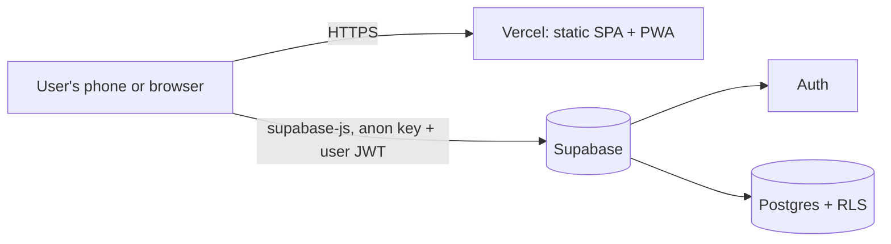

# TempoMio

**A mobile-first Progressive Web App to clock in and out, and to keep an exact balance of accumulated overtime.**

[](https://react.dev)
[](https://www.typescriptlang.org)
[](https://vite.dev)
[](https://tailwindcss.com)
[](https://supabase.com)
[](https://tempomio.vercel.app)

**Live:** [tempomio.vercel.app](https://tempomio.vercel.app)

## Why this exists

In many workplaces, hours are still recorded by signing a paper sheet, and overtime is not paid: it is accumulated and later exchanged for time off. Keeping that balance by hand is error-prone and rarely visible to the employee.

TempoMio replaces the sheet. The user taps once to clock in and once to clock out. The app compares each day against that person's own base schedule and keeps a running balance (an *hours bank*) that can be spent when leaving early or taking a day off. It was built for a small group of real users who use it every day, which is why the product decisions favour speed and clarity over feature count.

## Features

**Daily use**
- One-tap clock-in and clock-out, with a live timer while a shift is open
- Optional note at the end of a shift
- Manual correction of any day, for when someone forgets to clock in or out
- Streak of consecutive clocked days

**Overtime and hours bank**
- Overtime computed per day against the user's base schedule for that weekday
- Hours bank with a starting balance, manual adjustments (with a reason) and hours taken
- Hours can be taken for leaving early or for a full day off, and the app prepares a ready-to-send message for the manager
- Weekly timesheet-style view and monthly totals

**History and export**
- Interactive monthly calendar, color-coded by surplus or deficit; tap any day to add or edit it
- Monthly CSV export that opens correctly in Excel (semicolon separator, UTF-8 BOM)

**Accounts and administration**
- Guided first-run setup: name, base schedule and starting balance
- Access request (waitlist) from the login screen, approved or rejected by an admin
- Admin panel: users and last activity, access requests, suggestions
- In-app "Ideas" page for users to send suggestions

**Experience**
- Light and dark theme, with a selector
- Sidebar navigation on desktop, bottom bar on mobile
- Installable as a PWA on iOS and Android

## Architecture

TempoMio is a single-page application that talks directly to Supabase. There is no custom backend: authorization lives in the database, as Row Level Security (RLS) policies.



### Key decisions

- **Calculations run in the client, not in the database.** Overtime and the hours bank are derived from the stored clock-ins and the base schedule every time they are shown. Nothing derived is persisted, so correcting a past day can never leave a stale total. Data volumes are small (one row per user per day), so this is cheap.
- **One clock-in per day.** Each user has at most one entry per date, enforced by a unique constraint. Split shifts are intentionally out of scope.
- **Local dates.** Dates are handled in the user's local time, never converted through UTC, so a clock-in just after midnight lands on the right day.
- **Shifts crossing midnight** are computed correctly.

### Hours bank

The available balance is:

```
starting balance + manual adjustments + overtime earned − shortfalls − hours taken
```

Only clock-ins from the starting-balance date onward count, since earlier days are already included in that balance. A day without a complete clock-in does not subtract anything, except for hours the user has explicitly taken on it.

### Data model

| Table | Purpose |
|---|---|
| `perfiles` | User profile, linked to `auth.users` (name, `es_admin`) |
| `horarios_base` | Scheduled entry and exit time per weekday, per user |
| `fichajes` | Actual clock-in and clock-out, one row per user and day, with an optional note and `bolsa_minutos` (hours taken from the bank that day) |
| `ajustes_bolsa` | Starting balance (with the date from which clock-ins count) and manual corrections |
| `solicitudes_acceso` | Access requests from the login screen |
| `sugerencias` | Suggestions sent from the Ideas page |

### Security model

- Every table has RLS enabled. By default, a user can only read and write rows where `auth.uid() = user_id`.
- Administrators (`perfiles.es_admin = true`) can read other users' data for the admin panel. This goes through an `es_admin()` function declared `SECURITY DEFINER`, so the policy does not recurse into the table it protects.
- A database trigger prevents a user from granting themselves admin rights through the app: `es_admin` can only be changed from the Supabase dashboard.
- Access requests are insert-only for anonymous visitors. Only admins can read or change them.
- The client uses only the public anon key. It is safe to ship because RLS is what protects the data. `.env` is git-ignored.

## Project structure

```
src/
├── components/   UI building blocks (layout, clock-in card, base schedule, onboarding, ...)
├── lib/          Pure logic and data hooks: schedule.ts (time maths), bolsa.ts (hours bank),
│                 csv.ts (export), tema.ts (theme), fichajeHoy.ts (today's clock-in)
├── pages/        One component per route: Hoy, Semana, Historial, Bolsa, Ideas, Perfil, Admin
├── supabaseClient.ts
└── App.tsx       Session, profile loading and routing
supabase/
├── schema.sql    Full schema, rebuilt from the code
└── migrations/   Incremental, timestamped SQL changes
```

## Getting started

**Prerequisites:** Node.js and a Supabase project (the free tier is enough).

```bash
git clone https://github.com/Moulman/tempomio.git
cd tempomio
npm install

cp .env.example .env
# Fill in VITE_SUPABASE_URL and VITE_SUPABASE_ANON_KEY

npm run dev
```

### Database

For a new, empty Supabase project, run `supabase/schema.sql` in the SQL Editor. The file was reconstructed from the code, so review it before applying it to a project that already has data.

For an existing project, apply the files in `supabase/migrations/` in filename order. They only add objects and are written to be safely re-runnable.

Accounts are created by hand in Supabase (Authentication → Users). To make someone an admin, set `perfiles.es_admin = true` from the dashboard.

### Scripts

| Command | Description |
|---|---|
| `npm run dev` | Start the development server |
| `npm run build` | Type-check and build for production |
| `npm run preview` | Preview the production build locally |
| `npm run lint` | Run ESLint |
| `npm test` | Run unit tests (Vitest) |
| `supabase test db` | Run database and RLS tests (pgTAP) against local Supabase |

### Environment variables

| Variable | Description |
|---|---|
| `VITE_SUPABASE_URL` | Supabase project URL |
| `VITE_SUPABASE_ANON_KEY` | Supabase public anon key |

## Deployment and workflow

- **Production** is deployed on Vercel from the `main` branch. Any other branch gets its own preview URL and never reaches production.
- **Work happens on feature branches** and is merged into `main` only once reviewed and tested.
- **Database changes** are written as migration files, reviewed, and applied manually. Preview deployments use whichever Supabase credentials are configured for them, so use a separate Supabase project for anything experimental.

## Known limitations

- The interface is in Spanish only.
- No self-service sign-up yet: users request access and an admin creates the account.
- Test coverage is growing: unit tests cover the overtime and hours-bank logic, and pgTAP tests cover Row Level Security. End-to-end tests and CI are next.
- Single clock-in per day, by design.

## License

Copyright (c) 2026 Mansour Mouldi. All rights reserved.

The source is public so it can be read and evaluated, but it is not open source: no permission is granted to copy, modify, redistribute, sell or host it without written permission. See [LICENSE](LICENSE).
